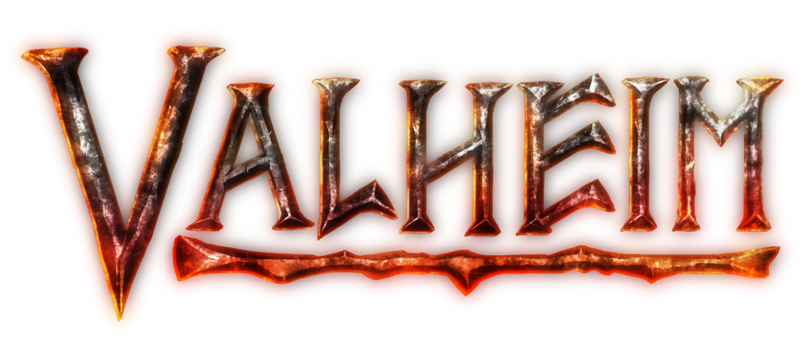

<p align="center">
  
</p>

<h1 align="center">POK-Valheim 1.0 — Multi-Realm Linux Docker Server Manager</h1>

<p align="center">
  <strong>Run, configure, mod, back up, and auto-update multiple Valheim 1.0 Dedicated Servers on Linux from one modern Web UI.</strong>
</p>

<p align="center">
  <a href="https://github.com/Acekorneya/POK-Valheim-1.0-Server-Manager"></a>
  <a href="LICENSE"></a>
  <a href="https://github.com/Acekorneya/POK-Valheim-1.0-Server-Manager"></a>
  <a href="https://github.com/Acekorneya/POK-Valheim-1.0-Server-Manager"></a>
  <a href="https://discord.gg/9GJKWjQuXy"></a>
  <a href="https://www.buymeacoffee.com/acekorneyab"></a>
</p>

---

**POK-Valheim** is an all-in-one, Docker-based **Valheim 1.0 Dedicated Server Manager** for Linux with a sleek dark Web UI.  
It makes it effortless to run **multiple Valheim realms side-by-side** (e.g., Main World, 3x Resource Farm, Creative Builder, Hardcore) so you and your friends can jump back and forth between servers, transfer saves, install Thunderstore mods, schedule backups, and keep Valheim updated automatically.

## Features

- **Multi-Realm Docker Control**: Create, start, gracefully stop (`SIGINT` world save), restart, and monitor multiple Valheim servers from one Web UI.
- **Shared SteamCMD Game Cache**: All realms share one `pok-valheim-gamefiles` Docker volume — running 3+ servers only downloads Valheim once.
- **Easy In-Game World Rules**: One-click presets (*Main Realm*, *Resource Farm 3x + Ore Portals*, *Creative Build*, *Hardcore*) plus full Valheim modifiers (`Combat`, `Resources`, `Portals`, `Death Penalty`, `Raids`, `No Build Cost`, `Passive Mobs`, `Player-Based Raids`, `No Map`, `Fire Hazards`, `Dungeon Build`, `Crossplay / PlayFab`).
- **Live Admin Dashboard**: Real-time container readiness (`Starting...` vs `Online`), players online, PlayFab Join Code, last world save time, CPU/RAM/Uptime, and live WebSocket console logs.
- **Valheim 1.0 Worlds & Saves Vault**: Supports both **Valheim 1.0 folder saves** and classic `.db`/`.fwl` files. Upload local saves, clone worlds between realms, hot-swap active worlds, download `.zip` backups, and edit `adminlist.txt`, `bannedlist.txt`, and `permittedlist.txt`.
- **Built-In Thunderstore Mod Manager (BepInEx)**: Browse 8,900+ Valheim mods sorted by Most Popular, Latest Updated, or Highest Rated. One-click install automatically sets up BepInEx + dependencies per server (isolated per realm), with Enable/Disable toggles, custom `.zip`/`.dll` uploads, and an in-browser `.cfg` editor.
- **Automated Backups & One-Click Safe Restore**: Cron-scheduled `.tar.gz` snapshots with retention pruning, manual snapshots with notes, and safe restore (stops server gracefully → creates safety snapshot → restores → restarts).
- **Steam Auto-Updates**: Monitors Steam AppID `896660` for new Valheim builds and optionally updates all servers automatically with pre-update backups.

---

## Easy Step-by-Step Setup (Linux Beginners Welcome)

### Step 1: Install Docker (skip if you already have Docker)

Open a terminal on your Linux machine (Ubuntu, Debian, etc.) and run:

```bash
curl -fsSL https://get.docker.com | sh
sudo usermod -aG docker $USER
```

> **Important:** After running those two lines, **log out and log back in** (or reboot) so your user has permission to run Docker without `sudo`.

Verify Docker works:
```bash
docker --version
docker compose version
```

---

### Step 2: Download POK-Valheim

```bash
git clone https://github.com/Acekorneya/POK-Valheim-1.0-Server-Manager.git pok-valheim
cd pok-valheim
```

---

### Step 3: Run the One-Command Setup

```bash
chmod +x scripts/setup-linux.sh
./scripts/setup-linux.sh
```

This script automatically:
1. Creates your `.env` file with a secure random token and picks a free Web UI port (`8080`, or `8088` if `8080` is already in use).
2. Builds the custom Linux Valheim + SteamCMD Docker image.
3. Builds and starts the **POK-Valheim Web Manager**.

When it finishes, it will print your exact Web UI link, for example:
```
Web UI:        http://192.168.1.100:8080
Default Login: admin / pokvalheim
```

---

### Step 4: Change Your Admin Password (Recommended)

Open `.env` in a simple editor:
```bash
nano .env
```

Change `POK_ADMIN_PASS=pokvalheim` to your own password (and optionally update `WEB_PORT` or `PUBLIC_HOST`).  
Press `Ctrl + O`, `Enter` to save, then `Ctrl + X` to exit.

Apply your new `.env` settings:
```bash
docker compose up -d pok-valheim-manager
```

---

### Step 5: Create Your First Valheim Realm!

1. Open the Web UI URL in your browser and sign in.
2. Click **+ New Realm**.
3. Pick a preset (like **Main Realm** or **Resource Farm**), enter a World Name and Server Password (at least 5 characters), and click **Create Realm**.
4. The first start downloads Valheim via SteamCMD (~2 GB, takes 1–2 minutes). Any additional realms you create will reuse the cached game files and boot in seconds!

---

## Firewall & Router Port Forwarding

If friends are connecting from outside your home network, forward these **UDP** ports on your router to your Linux machine's local IP:

| Service | Port(s) | Protocol |
|---|---|---|
| POK-Valheim Web UI | `8080` (or your `WEB_PORT` in `.env`) | TCP *(keep LAN-only or behind VPN for security)* |
| Realm 1 (default) | `2456-2457` | UDP |
| Realm 2 (auto-assigned) | `2458-2459` | UDP |
| Realm N | `2456 + 2*(N-1)` and `+1` | UDP |

If your Linux machine uses `ufw` firewall:
```bash
sudo ufw allow 8080/tcp
sudo ufw allow 2456:2465/udp
```

---

## Updating POK-Valheim Manager Later

Updating the Web Manager **does not stop or interrupt your running Valheim servers**:

```bash
cd ~/pok-valheim
git pull
docker compose --profile build-only build pok-valheim-server-image
docker compose up -d --build pok-valheim-manager
```

---

## Troubleshooting

- **`permission denied while trying to connect to the Docker daemon socket`**  
  Run `sudo usermod -aG docker $USER`, then log out and log back in.
- **Port `8080` is already in use**  
  The setup script automatically picks `8088` if `8080` is busy, or you can set any free port via `WEB_PORT=8088` in `.env` and run `docker compose up -d pok-valheim-manager`.
- **Where are my worlds and backups stored?**  
  Everything persists in `./data/` inside your `pok-valheim` folder (`./data/servers/<id>/config/worlds_local/` and `./data/backups/`).
- **Mods not loading?**  
  Make sure **Enable BepInEx Mod Loader** is checked on the **Mods** tab, then click **Save & Apply** (in the realm's Settings) or restart that realm.

---

## Project Structure

```text
pok-valheim/
├── docker-compose.yml          # Manager + Valheim server image build definition
├── .env.example                # Configuration template
├── LICENSE                     # MIT License
├── scripts/
│   └── setup-linux.sh          # One-command Linux setup script
├── valheim-server/
│   ├── Dockerfile              # Debian Slim + SteamCMD + Valheim Linux dependencies
│   └── entrypoint.sh           # flock-safe SteamCMD update, modifiers, BepInEx, SIGINT graceful save
└── manager/
    ├── Dockerfile              # Multi-stage build (React frontend + Node/TS API)
    ├── server/                 # Express + TypeScript + Dockerode + WebSockets + Thunderstore + Cron
    └── web/                    # React 19 + Vite + Tailwind CSS v4 + Lucide Icons
```

---

## Community & Support the Project

- **Discord Community**: [Join our Discord](https://discord.gg/9GJKWjQuXy) to get help, share setups, and stay updated.

If you find **POK-Valheim** useful and would like to support its development, you can buy me a coffee! Your support is greatly appreciated and helps me continue maintaining and improving the project.

<p align="left">
  <a href="https://www.buymeacoffee.com/acekorneyab">
    
  </a>
</p>

## License

This project is licensed under the **MIT License** — see the [LICENSE](LICENSE) file for details.
